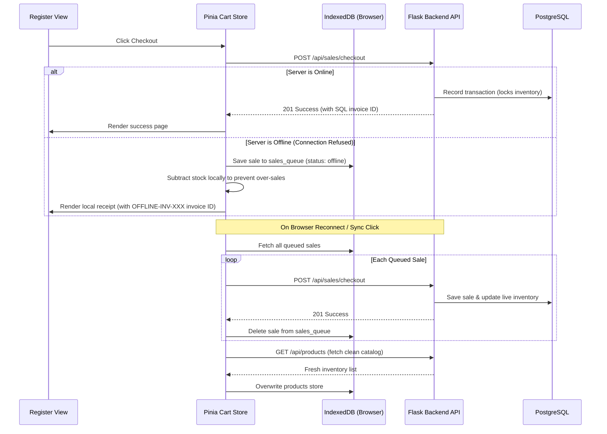

# Architecture Directive: Offline-First & Data Sync

This document describes the technical architecture of ApexPOS's offline-first capabilities, explaining local storage, transactional queuing, local quantity calculations, and database synchronization.

---

## 🛠️ 1. Client-Side Database: IndexedDB

ApexPOS uses **IndexedDB** as its primary client-side persistent cache. IndexedDB is non-blocking and asynchronous, allowing catalog querying and transaction queuing without freezing the UI.

### Database Details
The schema is managed by [indexedDb.js](file:///D:/ERP/POS/frontend/src/utils/indexedDb.js) with the following structure:
- **Database Name**: `ApexPOS_LocalDB`
- **Version**: `2`

### Object Stores
1. **`products`**: Caches all available catalog items (index: `barcode`, `sku`).
2. **`categories`**: Caches catalog grouping categories (index: `name`).
3. **`discounts`**: Caches active promotion codes for offline validation (index: `code`).
4. **`sales_queue`**: Stores checkouts processed while the terminal is offline.

---

## 🔄 2. Data Synchronization Flow

---

## 📦 3. Local Inventory Adjustments

To prevent double-selling of items (especially critical for products with limited quantity or sold by weight), the app performs a **local deductive step** when processing an offline sale:
1. When checkout is queued, the Pinia Cart store retrieves the item quantities in the transaction.
2. It fetches the corresponding products from the local IndexedDB cache.
3. The store subtracts the transaction quantities from the local product record (e.g. `20.000` kg - `1.500` kg = `18.500` kg).
4. The modified records are written back to IndexedDB.
5. The checkout screen catalog immediately updates to reflect this local deduction.

---

## ⚡ 4. Implementation Details

- **IndexedDB Wrapper**: Accessible at [indexedDb.js](file:///D:/ERP/POS/frontend/src/utils/indexedDb.js). Employs Promise mappings for clean `async/await` syntax.
- **Cart Sync Actions**: Configured in [cart.js](file:///D:/ERP/POS/frontend/src/store/cart.js#L75-L125) inside `syncOfflineSales()`. Validates queue length, loops through queued items, executes HTTP requests, and deletes successfully synced entries.
- **Auto-Sync Hook**: Triggered by window `online` event listeners bound in the main application layouts.
