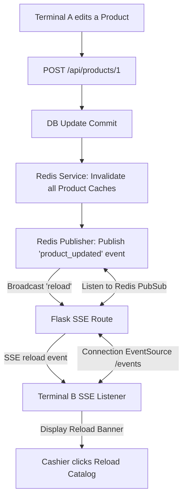

# Architecture Directive: Multi-Terminal Caching & Server-Sent Events

This document details the multi-terminal caching architecture of ApexPOS, focusing on terminal identification, Redis namespace caching, and real-time Server-Sent Events (SSE) reload triggers.

---

## 🖧 1. Terminal Caching Strategy

In multi-register stores, products are cached in Redis to minimize database read overhead. Since different terminals can be placed in different departments (or have location-specific availability), ApexPOS employs terminal-specific caches.

### Terminal Identification Header
Every frontend request includes a terminal identifier.
- Configured in [main.js](frontend/src/main.js) as a global Axios interceptor.
- It generates/reads a unique terminal UUID from local storage and appends it to requests as:
  ```http
  X-Terminal-Id: terminal-uuid-string
  ```

### Redis Key Namespace
On the backend, catalog endpoints check for the `X-Terminal-Id` header:
- **Redis Cache Key Structure**: `pos:products:cache:<terminal_id>`
- If a cached list exists for that terminal ID, the backend returns it immediately (saving database operations).
- If not, the backend queries the database, serializes the response, and writes it to Redis with the terminal-specific key namespace.

---

## 📢 2. Real-Time Broadcaster: Server-Sent Events (SSE)

When a product is created, modified, or checked out on one terminal, all other active terminals must be notified to prevent stale price or stock lookups. ApexPOS uses Server-Sent Events (SSE) to accomplish this.



### Invalidation & Broadcast Sequence
1. **Invalidation**: When a product is created or updated, the backend controller calls [RedisService.invalidate_products_cache()](backend/app/services/redis_service.py). This deletes all Redis keys matching the pattern `pos:products:cache:*`.
2. **Redis Pub/Sub Publish**: The same service publishes an event notification message (e.g. `'reload'`) to the Redis channel `pos:products:events`.
3. **SSE Connection**: Cashier terminals establish a persistent connection to `/api/products/events` using the browser's native `EventSource` API.
4. **SSE Event Handlers**:
   - The `/events` controller listens to the Redis subscription channel.
   - When a `'reload'` event is received, it writes an event message to all open SSE connections.
   - **Offline Resilience**: If Redis is offline, the endpoint falls back gracefully, sending a keep-alive comment event every 10 seconds to avoid connection timeout drops.

---

## 💻 3. Frontend Event Listener

The SSE listener is registered globally in the application shell layout:
* **Location**: [MainLayout.vue](frontend/src/components/layouts/MainLayout.vue)
* **Action**:
  - Initializes `new EventSource('/api/products/events')`.
  - Listens for message events.
  - When a message is received (content matches `'reload'`), it updates the local state to show a banner: *"Catalog updated. Click here to reload."*
  - The banner prompts the cashier to trigger a clean fetch, preventing cashier disruption during active scans.
